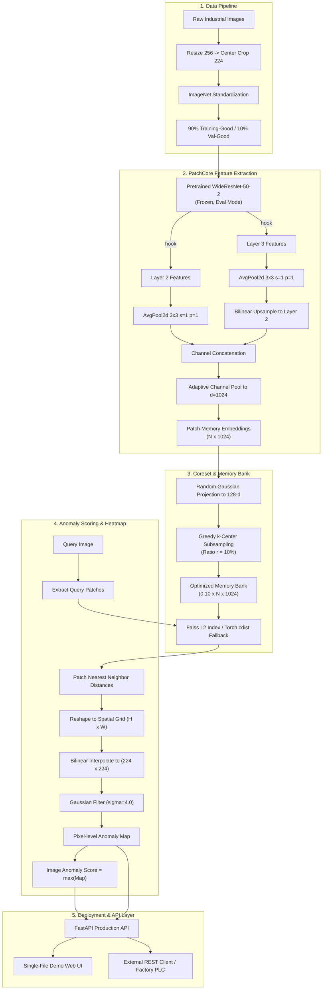

# Visual Inspector — Architecture & System Design

Visual Inspector is an industrial-grade, unsupervised defect detection engine implementing **PatchCore** (Roth et al., CVPR 2022) faithfully from scratch in PyTorch.

---

## 1. High-Level Pipeline

The system is organized into three decoupled pipelines: **Data Pipeline**, **Inference / Localization Engine**, and **Serving Layer**.

---

## 2. Core Components

### 2.1 Feature Extractor (`models/backbone.py`)
- **Backbone**: Wide ResNet-50-2 (`torchvision.models.wide_resnet50_2`), frozen in `eval()` mode.
- **Hook mechanism**: Uses PyTorch `RemovableHandle` forward hooks registered on `layer2` and `layer3`.
- **Zero gradient overhead**: Sets `param.requires_grad_(False)` on all parameters and runs forward passes inside `torch.no_grad()`.

### 2.2 Local Neighborhood Aggregation (`models/patchcore.py`)
- Aggregates spatial neighborhoods using `nn.AvgPool2d(3, stride=1, padding=1)` on each feature map.
- Bilinearly upsamples `layer3` to match `layer2` spatial resolution.
- Concatenates channels and adaptively pools across channel dimension to target dimension $d=1024$.
- Flattens into patch embeddings $(B \times H \times W, 1024)$.

### 2.3 Greedy k-Center Coreset Selection (`models/coreset.py`)
- Subsamples nominal training patch embeddings by ratio $r \in [0.01, 0.10, 1.00]$.
- **Random Projection**: Projects embeddings from 1024-d down to 128-d via fixed Gaussian projection matrix for distance computations, drastically accelerating coreset selection.
- **Batched Distance Updates**: Computes pairwise distances in chunks of 4,096 points to bound CPU/GPU memory consumption.

### 2.4 Unified kNN Engine (`models/knn.py`)
- **`FaissKNN`**: Fast exact nearest neighbor search via `faiss.IndexFlatL2`.
- **`TorchKNN`**: Pure PyTorch batched `torch.cdist` fallback requiring zero C++ compilation or native libraries.
- Standardized Euclidean distance output across both backends.

### 2.5 Serving & Model Registry (`serve/`)
- **Lazy loading**: Models are loaded on-demand from `artifacts/{category}/` on the first incoming request and cached in memory.
- **Safe deserialization**: Only tensor weights are loaded via `torch.load(..., weights_only=True)` and metadata is stored in plaintext JSON (`meta.json`).
